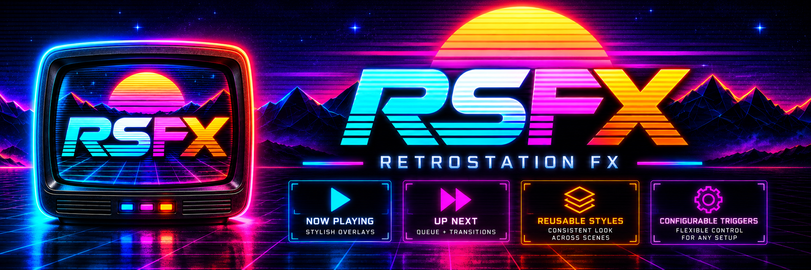
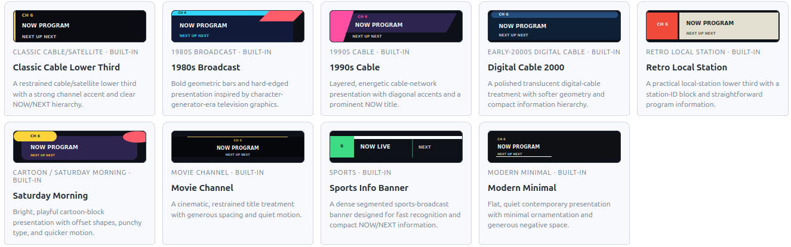

# RetroStation FX (RSFX)

<p align="center">
  
</p>

<p align="center">
  <a href="https://github.com/thehack904/RetroStation_FX/releases"></a>
  <a href="https://creativecommons.org/licenses/by-nc-sa/4.0/"></a>
</p>

**Bring broadcast-style on-screen graphics to your ErsatzTV channels.**

RetroStation FX adds customizable graphics such as **Now Playing banners, Now/Next information, and animated program introductions** to your ErsatzTV schedules. Choose a look, customize it in a web browser, and assign it to the programs you want. RSFX handles the graphics while ErsatzTV continues playing your channels.

RSFX is a separate, community-developed project that works with **ErsatzTV Legacy**. It does not require modifying ErsatzTV and is not an official ErsatzTV feature or endorsement.

## Features

- **Ready-made designs** inspired by classic cable TV, Saturday-morning cartoons, movie channels, sports, and modern broadcasts.
- **Easy customization** of text, layout, colors, size, opacity, position, and on-screen duration.
- **Now Playing and Now/Next graphics** using ErsatzTV schedule information.
- **Animated graphics** with fade and slide effects.
- **Flexible timing** for channel starts, program changes, and points during a program.
- **Reusable Styles** you can assign to more than one scheduled program.
- **Web interface** for editing and previewing your graphics.
- **Local-first operation** with no cloud account required.

See the [built-in design catalog](docs/BUILTIN-TEMPLATES.md) for the styles included in v0.1.0.

### Built-in overlay previews

These are the actual preview designs from the RSFX Template Library, shown without the editing controls. No sample television programs or channel logos are added.

<p align="center">
  
</p>

## Getting started

### What you need

- A working **ErsatzTV Legacy** installation with Script Graphics support.
- A supported **Debian/Ubuntu Linux** system for RSFX, with access to the ErsatzTV Script Graphics directory.
- A computer on your trusted network to open the RSFX web interface.

RSFX **must be installed on the same Linux host as ErsatzTV Legacy**. It integrates with ErsatzTV's local Script Graphics directory and service permissions; installing RSFX on a separate machine is not supported.

### 1. Install RSFX

Download the source archive from [GitHub Releases](https://github.com/thehack904/RetroStation_FX/releases), extract it, and run the installer from the extracted directory:

```bash
sudo bash ./retrostation_fx_linux.sh install
```

The installer displays the address of the RSFX web interface when installation is complete. Open that address in a browser. The default port is **5055**.

> RSFX does **not** have a login screen. Install it only on a trusted local network; do not forward its port to the public internet. For local-only access, use `sudo bash ./retrostation_fx_linux.sh install --local-only`. See [Security and networking](docs/TECHNICAL-REFERENCE.md#management-api-security).

### 2. Create your first Style

1. Open the RSFX web interface.
2. Choose a built-in template or create a Style.
3. Preview and adjust its appearance and timing.
4. Save the Style.

### 3. Sync the graphics with ErsatzTV

1. In RSFX, use the **Sync** control to synchronize your saved Styles with ErsatzTV.
2. Follow the instructions and status shown in RSFX. If manual synchronization is needed, use the provided command and make sure the selected ErsatzTV channel is not currently playing.
3. Once synchronization succeeds, open or reload the ErsatzTV **Program Schedule Items** editor.
4. Edit a schedule item, select the RSFX Style under **Graphics Elements**, and save.
5. Play the scheduled channel to see the overlay.

A successful Save alone does not mean ErsatzTV has discovered the new graphics. Complete **Sync** before attempting to assign them.

## Included designs

v0.1.0 includes designs for classic cable, 1980s broadcast, 1990s cable, early digital cable, local station, Saturday morning, movies, sports, and a clean modern look. You can start with any design and make it your own.

Browse the full [template list and usage notes](docs/BUILTIN-TEMPLATES.md).

## Help and documentation

- [Built-in templates](docs/BUILTIN-TEMPLATES.md) — choose your starting design.
- [Installation, upgrades, and verification](docs/USER-GUIDE.md) — common tasks and troubleshooting.
- [Technical reference](docs/TECHNICAL-REFERENCE.md) — architecture, security, networking, and service internals.
- [Maintainer guide](docs/MAINTAINER-GUIDE.md) — automated tests, CI, and versioning.
- [Release notes](docs/RELEASE-NOTES.md) — changes in v0.1.0.
- [Security policy](SECURITY.md) — report vulnerabilities privately.

## Security and updates

RSFX is intended for a **trusted home or lab network**. Its management interface does not provide user authentication. Do not expose port 5055 directly to the internet. Install/upgrade operations are designed to preserve your RSFX settings, Styles, and managed graphics; a full purge deliberately removes them. See the [user guide](docs/USER-GUIDE.md) for details.

## Contributing

Bug reports, suggestions, and pull requests are welcome via [GitHub Issues](https://github.com/thehack904/RetroStation_FX/issues). Please include the RSFX and ErsatzTV versions when reporting an issue.

## License

RSFX code, documentation, and original built-in artwork/templates are provided under [CC BY-NC-SA 4.0](LICENSE). This license includes a **noncommercial** restriction. Third-party dependencies retain their own licenses.

Maintained by [@thehack904](https://github.com/thehack904).
